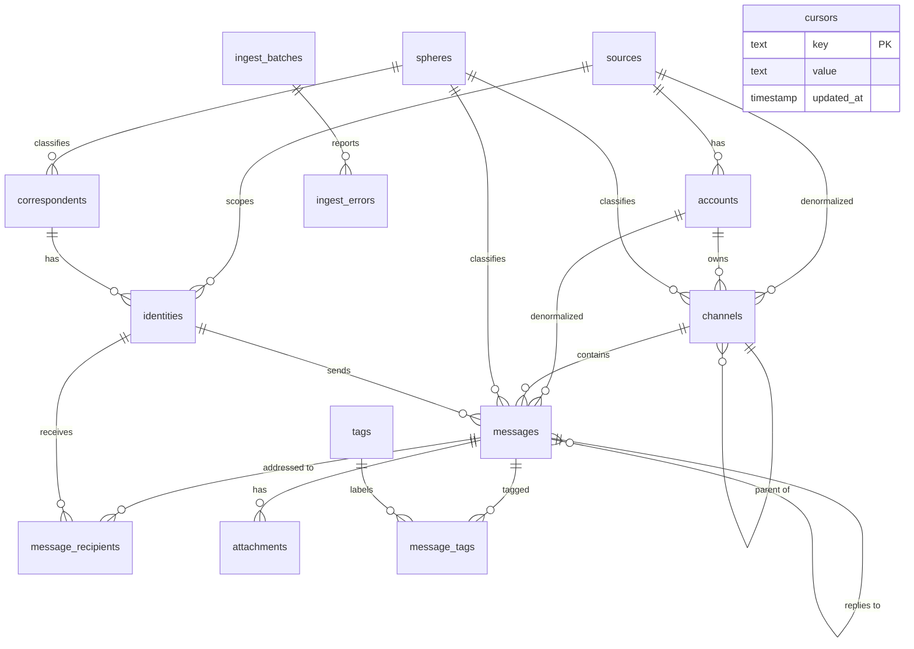

# CommHub — design

CommHub is a local-first communication hub. It is a daemon that stores messages
from many platforms in one place so they can be searched, correlated and
classified together. It does **not** talk to the platforms itself: separate
connector tools fetch data from a source and push it into the hub over REST.

```
 Teams ─┐
 Mail  ─┼─ connector ──POST /api/v1/messages────┐
 Mattermost ─┤            (single/batch/NDJSON) │
 Smartschool ─┘                                 ▼
                                         ┌─────────────┐
                                         │  CommHub    │── REST read API
                                         │  (SQLite)   │── web UI (later)
                                         └─────────────┘
```

Goals:

- one normalized, queryable message stream across all sources;
- tolerate lossy, inconsistent and evolving source APIs;
- idempotent ingestion that can be replayed safely;
- local-first storage (SQLite), easy to back up and inspect;
- keep platform credentials out of the hub.

Non-goals for v1: sending messages, real-time sync, full-text search (planned),
multi-user tenancy, blob storage of attachments (paths/URLs only).

## 1. Domain model

| Concept | Meaning |
| --- | --- |
| **Source** | A platform or protocol: `mattermost`, `teams`, `mail`, `opencode`, `smartschool`, … |
| **Account** | One configured connection/identity on a source: a mail account, a user on a specific Mattermost server. Holds (a reference to) credentials. |
| **Channel** | A container of messages on an account: channel, DM, group, thread, mail folder, course, session. |
| **Correspondent** | A person or bot in your world. Cross-platform. |
| **Identity** | A handle that identifies a correspondent on one source: e-mail address, username, member id, phone number. |
| **Sphere** | Personal sphere of life: `work`, `personal`, `hockey`, `school`, … |
| **Message** | One normalized message/post/mail. |
| **Attachment** | A file belonging to a message (metadata + optional local path/URL). |
| **Tag** | Free-form label, many-to-many with messages. |
| **Ingest batch** | Audit record of one ingestion call, including per-item errors. |

### Why source *and* account?

A source is a protocol family; an account is a concrete connection. Without the
split, two mail accounts, or two Mattermost instances, collide on folder names
and usernames. Every channel, and therefore every message, belongs to exactly one
account. Connectors authenticate per account.

### Why correspondent *and* identity?

The same human appears as `jo@example.org` in mail and `jo` on Mattermost. A
**correspondent** is the person; **identities** are the per-source handles. This
lets the hub group a conversation partner across platforms without forcing
connectors to do entity resolution. Identities are source-scoped, because
usernames are only unique per platform.

### Why spheres on multiple levels?

A sphere can be set on an account's channel (e.g. all `#hockey` messages), on a
correspondent, or on a single message. The message stores the effective sphere
(denormalized) so filtering never needs a join. Precedence at ingest time:

```
message.sphere  >  channel.sphere  >  correspondent.sphere  >  account default  >  none
```

v1 implements the first two plus a source/account-level default in the future.

## 2. Schema



### sources

| column | type | notes |
| --- | --- | --- |
| `id` | text PK | UUIDv7 |
| `slug` | text unique | stable key used by connectors: `mail`, `mattermost`, … |
| `name` | text | display name |
| `kind` | text | coarse kind for UI grouping, free-form (`chat`, `email`, `lms`, `code`) |
| `description`, `enabled`, `config` (JSON), timestamps | | |

`slug` is the natural key: connectors never need to know internal ids.

### accounts

| column | type | notes |
| --- | --- | --- |
| `id` | text PK | |
| `source_id` | text FK | cascade delete |
| `slug` | text | unique per source |
| `name` | text | |
| `external_user` | text | your own handle on this account; used to detect outbound messages |
| `external_user_kind` | text | default `username` (`email` for mail) |
| `secret_ref` | text | name of an env var/keyring entry — **never the secret itself**; never serialized |
| `config` (JSON), `enabled`, `last_synced_at` | | |

### channels

| column | type | notes |
| --- | --- | --- |
| `id` | text PK | |
| `source_id` | text FK | denormalized for filtering |
| `account_id` | text FK | |
| `external_id` | text | platform id, folder path, course id, session id |
| `name`, `topic`, `kind` | text | kind: `channel`, `direct`, `group`, `thread`, `folder`, `feed`, `course`, `session` |
| `parent_id` | text FK (self) | for sub-channels/threads/folders |
| `sphere_id` | text FK, nullable | default sphere for messages in this channel |
| `metadata` (JSON) | | |

Unique: `(account_id, external_id)`. External ids are only unique per account.

### correspondents

| column | type | notes |
| --- | --- | --- |
| `id` | text PK | |
| `display_name` | text | |
| `sort_name` | text | optional curated sort key |
| `is_self` | bool | one or more correspondents representing you |
| `sphere_id` | text FK, nullable | |
| `notes`, `avatar_url`, `metadata` (JSON) | | |

### identities

| column | type | notes |
| --- | --- | --- |
| `id` | text PK | |
| `correspondent_id` | text FK | |
| `source_id` | text FK | |
| `kind` | text | `email`, `username`, `user_id`, `member_id`, `phone`, `handle` |
| `value` | text | as seen in the source |
| `normalized_value` | text | comparison key (see below) |
| `display_name`, `verified`, `metadata` | | |

Unique: `(source_id, kind, normalized_value)`. Normalization:

- `email`, `username`, `member_id`, `user_id`: trim + lowercase;
- `phone`: keep `+` and digits;
- `handle`: trim only (case-sensitive platforms exist).

### messages

| column | type | notes |
| --- | --- | --- |
| `id` | text PK | UUIDv7, time-sortable |
| `source_id`, `account_id`, `channel_id` | text FK | denormalized for query speed |
| `external_id` | text | platform id (mail `Message-ID`, Matrix event id, …) |
| `thread_id` | text | external conversation key |
| `parent_id` | text FK (self) | resolved reply-to |
| `sender_id` | text FK identity, nullable | null for system/imported notifications |
| `direction` | text | `inbound`, `outbound`, `internal` |
| `kind` | text | `chat`, `email`, `post`, `notification`, `event`, `system`, `comment` |
| `subject`, `body`, `preview`, `language`, `url` | text | |
| `body_format` | text | `plain`, `markdown`, `html` |
| `sent_at` | timestamp | authoritative source time, UTC |
| `received_at` | timestamp, nullable | provider delivery time |
| `ingested_at` | timestamp | first ingestion, UTC |
| `edited_at`, `deleted_at` | timestamp, nullable | `deleted_at` = deleted in the source |
| `content_hash` | text | SHA-256 of normalized content; drives idempotency |
| `importance` | int | connector hint, 0 = normal |
| `is_read`, `is_starred`, `is_archived` | bool | **hub-local state**, connectors never overwrite these |
| `sphere_id` | text FK, nullable | effective sphere |
| `metadata` (JSON) | | source-specific, stable values only |
| `raw` (JSON) | | original payload, for replay/debugging |

Unique: `(account_id, external_id)`.
Indexes: `(channel_id, sent_at)`, `(source_id, sent_at)`, `sent_at`, `sender_id`,
`thread_id`, `content_hash`, `sphere_id`, `(direction, kind)`, `is_read`.

Soft delete is **not** used: a `gorm.DeletedAt` would make unique keys collide on
re-ingestion. Instead `deleted_at` is an ordinary nullable column, set through
`deleted_in_source_at` when the source removed the message; ingestion can
resurrect a message later. `DELETE /api/v1/messages/{id}` is a real delete, for
messages that should never have been ingested. Hub-side deletion (user hides a
message) should become a separate `hidden_at` column later.

### attachments

| column | notes |
| --- | --- |
| `id`, `message_id` FK | |
| `external_id`, `filename`, `mime_type`, `size` | |
| `sha256` | content address, dedupe hint |
| `storage_path` | optional path in the connector's blob directory |
| `url` | optional remote URL |
| `metadata` (JSON) | |

Attachments are replaced as a set on message update. The hub stores uploaded
bytes itself in `attachments_dir` (`ab/cd/<sha256>`, mode `0600`), content
addressed so the same file is stored once. When a connector uploads a blob
before ingesting the message, `storage_path` is rewritten to the hub's copy and
the read API exposes `/api/v1/attachments/<sha256>` as the URL; a path from the
connector's machine is kept as-is when no blob was uploaded.

### tags / message_tags

`tags(id, slug unique, name, color)`. `message_tags(message_id, tag_id)` with a
composite primary key. Tags are created on first use from the connector's tag
names; slug is lowercased, trimmed, spaces → `-`.

### message_recipients

`(message_id, identity_id, role)` composite PK. Roles: `to`, `cc`, `bcc`,
`mention`, `watcher`. The sender is **not** stored here.

### ingest_batches / ingest_errors

`ingest_batches(id, mode, status, total, created, updated, unchanged, failed,
started_at, finished_at, error)` and `ingest_errors(batch_id, position,
external_id, error, payload)`. Kept for connector observability; safe to prune.

### cursors

`cursors(key primary key, value, updated_at)`. A connector-owned position marker
("last synced post id"), so connectors do not need their own state file and can
move between machines without re-syncing. Keys are opaque strings up to 200
characters; they travel as one URL path segment, so escape characters like `:`
as `%3A`.

## 3. Ingestion

### Natural keys, not internal ids

A connector payload identifies everything by natural key:

| object | key in payload |
| --- | --- |
| source | `source` slug |
| account | `account` slug (default `default`) |
| channel | `(account, channel.external_id)` |
| sender/recipient | `(source, kind, value)` |
| sphere | `sphere` slug |
| tag | tag name |

The hub creates missing sources, accounts, channels, correspondents and
identities on the fly. This keeps connectors dumb and replayable.

### Idempotency

1. Look up the message by `(account_id, external_id)`.
2. Not found → insert, link recipients/tags/attachments, `status=created`.
3. Found and `content_hash` equal → do nothing (local flags preserved),
   `status=unchanged`.
4. Found and hash differs → update content, set `edited_at`, replace
   recipients/tags/attachments, `status=updated`.

`content_hash` covers subject, body, kind, body format, URL, language, preview,
`sent_at`, sender identity, attachment names/hashes/sizes, recipient keys, tag
slugs and metadata. Connectors must therefore keep `metadata` stable and put
volatile data in `raw`.

Concurrency: ingestion is serialized per account by the SQLite write lock. A
connector that runs twice at once may race on lookups; the unique index turns
that into a retryable error instead of a duplicate row.

### Modes

| mode | endpoint | use |
| --- | --- | --- |
| single | `POST /api/v1/messages` | interactive, low volume |
| batch | `POST /api/v1/messages/batch` | backfill / periodic sync |
| stream | `POST /api/v1/messages/stream` | NDJSON, long-running connector |

All modes accept the same message object. Batch/stream are best-effort per item:
one bad message does not abort the others (each item is a savepoint inside one
transaction). The response reports per-item status and errors.

### Write path

```
HTTP handler
  └─ ingest.Service
       ├─ resolve source + account         (create if missing)
       ├─ resolve channel                  (create/update)
       ├─ resolve sphere
       ├─ resolve sender/recipient identities + correspondents
       ├─ upsert message (hash compare)
       └─ replace recipients, tags, attachments
```

## 4. REST API

Auth: when `api_tokens` is configured, every `/api/v1/*` request needs
`Authorization: Bearer <token>`. A token prefixed with `read:` only gets `GET`,
`HEAD` and `OPTIONS`; one prefixed with `write:` only gets the other methods; a
bare token gets both. A valid token without the needed scope gets `403`. Health
endpoints are public.

### Ingest

`POST /api/v1/messages`

```json
{
  "source": "mattermost",
  "source_kind": "chat",
  "account": "work",
  "channel": {
    "external_id": "channel-42",
    "name": "general",
    "kind": "channel",
    "sphere": "work"
  },
  "external_id": "post-1001",
  "thread_id": "post-1000",
  "parent_external_id": "post-1000",
  "sender": { "kind": "username", "value": "jdoe", "display_name": "John Doe" },
  "recipients": [
    { "kind": "username", "value": "me", "role": "mention" }
  ],
  "direction": "inbound",
  "kind": "chat",
  "subject": "",
  "body": "Hello @me",
  "body_format": "markdown",
  "sent_at": "2026-11-24T09:00:00Z",
  "sphere": "work",
  "tags": ["urgent"],
  "attachments": [
    { "filename": "spec.pdf", "mime_type": "application/pdf",
      "size": 12345, "sha256": "…", "storage_path": "/blobs/spec.pdf" }
  ],
  "metadata": { "reactions": 2 },
  "raw": { "whatever": "the platform returned" }
}
```

Response `201` (or `200` for `updated`/`unchanged`):

```json
{ "id": "0192…", "status": "created" }
```

`POST /api/v1/messages/batch` takes either `{"messages": [...]}` or a bare
array. Limit 1000. Response:

```json
{
  "batch_id": "0192…",
  "total": 2, "created": 1, "updated": 0, "unchanged": 1, "failed": 0,
  "results": [
    { "index": 0, "external_id": "post-1001", "id": "0192…", "status": "created" },
    { "index": 1, "external_id": "post-1002", "id": "0192…", "status": "unchanged" }
  ]
}
```

`POST /api/v1/messages/stream` accepts NDJSON, one message per line, and returns
the same aggregate result.

Required fields: `source`, `channel.external_id`, `external_id`, `body` (may be
empty for attachment-only messages). `sent_at` defaults to now and is truncated
to whole seconds; `body_format` defaults to `plain`; `kind` defaults to `chat`;
`direction` is derived (sender is `is_self` → `outbound`, otherwise `inbound`).

`deleted_in_source_at` turns a payload into a deletion: the existing row is
flagged, nothing else changes, and a delete for a message the hub never saw is a
no-op (`unchanged`). Re-ingesting the message with its content leaves the flag
alone, so a deleted message stays deleted.

### Read

| endpoint | description |
| --- | --- |
| `GET /api/v1/messages` | cursor-paginated list, newest `sent_at` first |
| `GET /api/v1/messages/{id}` | one message with channel, sender, recipients, tags, attachments |
| `PATCH /api/v1/messages/{id}` | local state: `is_read`, `is_starred`, `is_archived`, `sphere`, `tags` |
| `DELETE /api/v1/messages/{id}` | hard delete a message that should not exist (recipients, attachments and tags cascade) |
| `PUT /api/v1/attachments/{sha256}` | upload a blob; the body must hash to `sha256` (`201` created, `200` when it already existed) |
| `GET /api/v1/attachments/{sha256}` | download a blob (content type sniffed, `ETag` is the checksum) |
| `GET /api/v1/cursors` | list connector cursors |
| `GET /api/v1/cursors/{key}` | one cursor |
| `PUT /api/v1/cursors/{key}` | create or replace a cursor (`{"value": "..."}`) |
| `DELETE /api/v1/cursors/{key}` | remove a cursor |
| `GET /api/v1/sources` | sources with accounts |
| `PATCH /api/v1/accounts/{id}` | set `external_user`/kind, name, secret ref, config |
| `GET /api/v1/channels?source=&account=` | |
| `GET /api/v1/correspondents?q=&sphere=` | with identities |
| `GET /api/v1/spheres` | |
| `POST /api/v1/spheres` | create |
| `POST /api/v1/correspondents` | create with identities |
| `POST /api/v1/correspondents/{id}/identities` | attach a handle (merge a person across sources) |
| `GET /api/v1/tags` | |
| `GET /api/v1/ingest/batches` | recent ingestion calls with errors |
| `GET /api/v1/stats` | row counts, per-source counts, time range |
| `GET /healthz` | liveness |

Message list filters (all optional; repeatable parameters are noted):

| parameter | matches |
| --- | --- |
| `id`, `external_id`, `thread_id`, `parent_id`, `content_hash` | exact |
| `source`, `source_id`, `source_kind` | source slug, internal id, or kind |
| `account`, `account_id` | account slug or internal id |
| `channel`, `channel_external_id`, `channel_id`, `channel_name`, `channel_kind` | channel external id, internal id, name substring, or kind |
| `sender`, `sender_kind`, `sender_id`, `sender_correspondent` | sender handle (optionally typed), identity id, or correspondent id |
| `recipient`, `recipient_kind`, `recipient_id`, `recipient_role`, `recipient_correspondent` | recipient handle, identity id, role, or correspondent id |
| `correspondent_id` | correspondent as sender **or** recipient |
| `sphere`, `sphere_id`, `no_sphere` | sphere slug/id, or messages without a sphere |
| `tag` (repeatable or comma-separated), `tag_mode` (`any`/`all`) | tags |
| `direction`, `kind`, `body_format`, `language` | exact |
| `subject`, `body`, `q` | substring; `q` searches subject, body, preview and url |
| `is_read`, `is_starred`, `is_archived`, `deleted`, `has_attachments` | boolean |
| `unread`, `starred` | legacy shortcuts |
| `importance_min`, `importance_max` | inclusive range |
| `attachment_mime`, `attachment_filename` | substring |
| `attachment_sha256` | exact |
| `since`/`until`, `received_since`/`received_until`, `ingested_since`/`ingested_until` | time range, RFC 3339 or `YYYY-MM-DD` |
| `sort`, `order` | `sent_at` (default), `ingested_at`, `created_at`, `importance`; `desc` (default) or `asc` |
| `limit`, `cursor` | page size (default 50, max 500) and opaque cursor |

Handles are normalized like ingestion (case-insensitive for e-mail addresses and
usernames); add `sender_kind`/`recipient_kind` when a value could be ambiguous.
Invalid booleans, times, sort fields, tag modes and cursors return HTTP 400.

The list response omits the `raw` payload of each message; fetch a single
message to get it. The cursor encodes the sort field, order, position and
message id, so it cannot be reused with a different ordering and `sent_at`
collisions paginate stably.

## 5. Storage & performance

- SQLite via `glebarez/sqlite` (pure Go, no cgo), WAL mode, `busy_timeout=5s`,
  `synchronous=NORMAL`, foreign keys on, `temp_store=MEMORY`.
- One connection: SQLite allows a single writer; serializing removes
  `SQLITE_BUSY` retries. Batches amortize the commit cost, which is what makes
  high throughput possible. A separate read-only pool can be added later.
- Batch size default 500 (configurable). One transaction per chunk with a
  savepoint per message.
- No `SELECT *` joins in list queries; denormalized `source_id`/`account_id`
  avoid joins entirely for the common filters.
- Future: FTS5 virtual table for body/subject search; content-hash based blob
  dedupe; partition/prune old `raw` payloads.

## 6. Security

- Connectors push to a local/private address; bind to `127.0.0.1` by default.
- Bearer tokens in config/env (`COMMHUB_API_TOKENS`); compare with
  `subtle.ConstantTimeCompare`. Optional `read:`/`write:` scopes limit a token
  to reads or writes.
- `listen: unix:/path` creates a mode-`0600` socket, so no port is exposed and
  no token is needed for local use.
- Platform credentials live with the connectors. The hub stores only
  `secret_ref` names, which are never serialized.
- `raw` payloads may contain personal data: DB file permissions + backups are the
  operator's responsibility.

## 7. Roadmap

1. v1 (this repo): schema, migrations, ingest (single/batch/stream), read API.
2. Connectors: `commhub-mail`, `commhub-mattermost`, `commhub-teams`,
   `commhub-smartschool`, `commhub-opencode`.
3. Web UI (templ + Tailwind) and FTS5 search.
4. Rules engine: auto-tag/sphere based on sender, channel, keywords.
5. Per-account sync metadata (`last_synced_at`) on top of the generic cursors.
